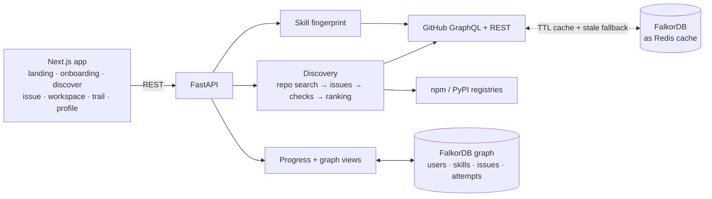

# Breadcrumbs

**Follow the trail from issue to merged PR.**

> **An AI agent with graph memory.** Breadcrumbs finds open-source issues you can actually get merged. Then **Guide**, its AI agent, uses FalkorDB as its context and memory to write everything you need to land the fix: a claim comment, the exact setup commands and a PR description, following that repo's own rules. It remembers what it learns, for you and for the next newcomer to that repo.

Built for **Graph Hacks: Context for AI Agents** (FalkorDB). Tracks: **Agents That Act on Connected Data** and **Agent Memory & Coordination**.

**At a glance**
- 🤖 **Guide agent** (Claude): reads your graph and the repo's rules, writes personalised drafts, shows an agent trace of every step and query → [The Guide agent](#the-guide-agent)
- 🧠 **Memory in FalkorDB**: notes about you, facts about each repo shared across users, every issue you were shown, saved, skipped and picked
- 🔎 **Explainable matching**: every recommendation is a graph path you can see, with the Cypher that produced it

---

## The problem

People who want to contribute to open source give up early:

1. **"Good first issue" labels mislead.** Many of those issues are stale, already claimed in the comments, or not beginner-sized at all.
2. **Maintainers go quiet.** A newcomer's first PR sits for weeks, and they never come back.
3. **It's hard to know where to start.** Which repo, which issue, and what to do next.

Sites like goodfirstissue.dev list labelled issues. None of them tell you whether an issue **fits your skills**, whether it's **still free**, or whether **the maintainers actually merge newcomers' PRs**.

## What Breadcrumbs does

| | |
|---|---|
| **Reads your skills** | From your public repos, the dependency files in them (`package.json`, `requirements.txt`, `pyproject.toml`) and the PRs you've had merged into other projects. Recent work counts more; merged PRs count most. |
| **Finds issues you can land** | Unclaimed, recently active issues in mid-size, active repos in your languages, and in the libraries you already depend on. |
| **Explains every match** | Plain-language reasons ("maintainers usually reply within 13h · 7 newcomer PRs merged here in 90 days"), a fit score with its full breakdown, a merge-chance estimate, and the **path in your graph** from you to the issue. |
| **Re-checks before you commit** | Picking an issue re-fetches it live. If someone was assigned, opened a PR or claimed it in a comment since you saw it, you're told why. |
| **Guide agent writes the hard part** | In each issue's workspace, ✨ **Write with Guide** reads the repo's CONTRIBUTING, PR template, README, package scripts and CI on GitHub, plus what your graph knows about you, and writes a claim comment, the exact setup commands, and a PR description in the repo's template. It shows an agent trace of every step and query. |
| **Remembers, and shares what it learns** | Guide saves facts it learned about the repo ("a signed CLA is required, checked by cla.yml") to the repo's node, so the **next newcomer's Guide starts with them**, and notes about you to yours (see and delete them on Profile). Everything you were shown, saved, skipped and picked lives in the graph too. |

## Demo

```bash
make db && make api && make web      # then open http://localhost:3000
```

1. **Landing → "Find issues you can land"** → enter a GitHub username.
2. **Onboarding** reads their GitHub, shows the skills it found, and asks which languages to search, what difficulty and how many hours a week.
3. **Discover** lists ranked issues. Click one to see why it fits, the score breakdown and the graph path. Keys: `j`/`k` move, `enter` opens, `s` saves, `x` skips.
4. **Issue page:** the issue's text and how the repo treats newcomers (reply time, newcomer merge rate). Or **paste any GitHub issue URL** on Discover to score it.
5. **"I'll take this"** re-checks it live, then opens the **workspace**: stepper, next step, and the Guide tab.
6. **✨ Write with Guide** (about 20 seconds): watch the steps, open the **agent trace** to see each graph query, and get a claim comment, setup commands and a PR description written for this repo and for you, each citing the files they came from. Run it again: the trace shows it recalled the repo facts the first run saved.
7. **Home**, **My trail** and **Profile** show what you're working on, your trail as a graph, and what Guide remembers about you.

## Why a graph (FalkorDB)

Each recommendation is a path: **you → a skill you have ← the issue needs it → in a repo that treats newcomers well**. We store that path and draw it, and every graph in the UI has a **"See the query"** toggle showing the Cypher that produced it:

```cypher
MATCH (u:User {login: $login}), (i:Issue {id: $issue})-[:IN]->(r:Repo)
OPTIONAL MATCH (i)-[:NEEDS]->(t:Tech)
OPTIONAL MATCH (u)-[k:KNOWS]->(t)
OPTIONAL MATCH (u)-[:WORKING_ON]->(:Attempt)-[:FOR]->(past:Issue)-[:IN]->(r)
  WHERE past.id <> i.id
RETURN u.login, u.name, t.name, k.level, i.id, i.title, i.difficulty,
       r.name, r.stars, r.reply_hours, r.newcomer_merges_90d,
       collect(DISTINCT past.id)
```

The graph is the product's memory: skills, preferences, what we showed you and why, what you saved or skipped, every issue you picked and its timeline of events, and what you learned. One FalkorDB instance also serves as the Redis cache for GitHub responses.

```
(User)─KNOWS {level}─▶(Tech)◀─NEEDS─(Issue)─IN─▶(Repo {reply_hours, newcomer_merges_90d})
(User)─SHOWN {fit, at}─▶(Issue)        (User)─SAVED / SKIPPED {reason}─▶(Issue)
(User)─WORKING_ON─▶(Attempt {status})─FOR─▶(Issue)
(Attempt)─HAS_EVENT─▶(Event {type, at})        append-only timeline
(User)─LEARNED─▶(Tech)
(User)─REMEMBERS─▶(Memory)        notes Guide saved about you
(Repo)─HAS_FACT─▶(RepoFact {text, source})   what Guide learned about a repo, shared with everyone
```

## The Guide agent

Recommending an issue isn't enough: newcomers still get stuck on "how do I claim this, set it up, and write the PR?". Guide does that work, using the graph as its context and memory:

| Step | What it does | Graph / tool |
|---|---|---|
| 1 | Reads your profile: level, skills, hours per week | `MATCH (u:User)-[k:KNOWS]->(t:Tech)` |
| 2 | Recalls what it remembers about you | `MATCH (u:User)-[:REMEMBERS]->(m:Memory)` |
| 3 | Recalls what Breadcrumbs already learned about this repo, from anyone's earlier runs | `MATCH (r:Repo)-[:HAS_FACT]->(f:RepoFact)` |
| 4 | Reads the repo's own rules on GitHub in one call: CONTRIBUTING, PR template, README, package.json / pyproject / Makefile, CI workflows | GitHub GraphQL |
| 5 | Writes the drafts with Claude: rules followed exactly, real commands only, personalised to your level and time | Claude (structured output) |
| 6 | Saves what it learned: up to 3 repo facts, each citing its file, and notes about you | `MERGE (r:Repo)-[:HAS_FACT]->(f:RepoFact)` · `(User)-[:REMEMBERS]->(Memory)` |

Each run returns an **agent trace** of these steps and their queries, shown in the UI. Guide never posts to GitHub: you copy the drafts and post them yourself.

**Model:** with `LLM_API_KEY` set, Guide calls `claude-opus-5` through the Anthropic SDK. Without a key, for local demos, it runs through your local Claude Code CLI (`claude -p`).

## How matching works

1. **Good repos first, then their issues.** Searching issues directly mostly finds tiny personal repos whose owners label their own to-do lists "help wanted". So we search for repos with 200–30k stars, pushed in the last 30 days, with labelled issues, in your languages. We add the repos behind your dependencies (looked up on npm and PyPI), then fetch their open issues in batched GraphQL calls. We drop issues that are assigned, already have a linked PR, or haven't been touched in 60 days.
2. **Check each candidate.**
   - *Claims:* we read the latest comments for phrases like "can I work on this?". A claim expires after 21 days unless a maintainer said go ahead.
   - *Maintainer speed:* median time to first review or comment on recent PRs, ignoring bots.
   - *Newcomer merges:* merged PRs by people who aren't bots or maintainers and appear once in the last 50 PRs. We call them "newcomers", not "first-timers", because GitHub only reports an author's *current* relationship to a repo.
3. **Score it. Plain arithmetic, no LLM, so every number can be explained:**
   ```
   fit = 0.35 skill + 0.20 difficulty + 0.20 maintainer speed + 0.15 newcomer merges + 0.10 freshness
         +0.05 if it's in a library you use, ×0.3 if someone claimed it
   ```
   Difficulty aims one step above your level, unless you chose one. The merge chance is the repo's newcomer merge rate, adjusted for difficulty and maintainer speed. It's a rough estimate, not a calibrated probability.

A new user costs at most 3 searches plus a handful of GraphQL calls. Results are cached for 15 minutes, repo stats for 24 hours. If GitHub is down or rate-limited, we serve the last saved copy and the UI says the data may be out of date.

## Architecture



**Stack:** Next.js 16, React 19, TypeScript, Tailwind, SWR · FastAPI, Pydantic, httpx · FalkorDB · GitHub GraphQL and REST APIs.

## Status

**Built and tested** (72 backend tests, plus a scripted browser walk-through of every screen):
- Skill fingerprint
- Discovery and ranking with explanations
- Live re-check before picking
- Save, skip and preferences
- Issue page and "why this match" graph
- Workspace with stepper, guide and timeline
- Home, My trail, and Profile with the trail graph

- **Guide agent:** repo rules plus graph context in, personalised drafts out, an agent trace, and shared repo memory

**Next:**
- **Sync from GitHub:** your commits, PRs, reviews and merges become timeline events, so the stepper moves by itself.
- **Code map:** fetch only the files around an issue (no clone), map which functions call which, and light up a reading path from where the code starts to the function to change and its test.
- **Past PRs** that touched the same code, as worked examples.
- **Level up after a merge:** a slightly harder next issue.
- **Guide, more tools:** read the live issue thread, find past PRs, explain review comments, and run read-only Cypher on the graph.

The full plan, tasks and user journeys are in [docs/TRACKER.md](docs/TRACKER.md).

## Run it

Needs Docker, [uv](https://docs.astral.sh/uv/) and Node 20+.

```bash
cp .env.example .env     # set MODE=live and GITHUB_TOKEN for real data
make db                  # FalkorDB on :6379, browser UI on http://localhost:3002
make api                 # backend on http://localhost:8000 (API docs at /docs)
make web                 # frontend on http://localhost:3000
make test                # backend tests (needs `make db`)
make lint                # ruff + eslint
```

- **Live mode** (`MODE=live`) needs `GITHUB_TOKEN`: a classic personal access token with no scopes is enough, since we only read public data.
- **Guide** needs `LLM_API_KEY` (Anthropic), or the Claude Code CLI installed and logged in for local runs. In mock mode it explains that it can't run.
- **Mock mode** (`MODE=mock`, the default) runs offline on GitHub responses recorded from one account in `backend/fixtures/github/`. Any username returns that recorded data. Because matches drop issues not updated in 60 days, mock results thin out as the recordings age. The tests pin the date, so they're unaffected.
- **No sign-in:** the app remembers your username in the browser, and you post the comments it drafts yourself.

```
backend/app/
├── config.py         MODE=mock|live, per-service fallback
├── github.py         live client (TTL cache + stale fallback) or recorded fixtures
├── fingerprint/      skill fingerprint: one GraphQL call → skills + level
├── discovery/        repo search → issues → checks → ranked cards; single-issue detail; live re-check
├── registry.py       npm/PyPI package → GitHub repo
├── agent/            Guide agent: repo rules + graph context → Claude → drafts, trace, memory
├── graph/            schema, progress (users, attempts, events, shown/saved/skipped), status machine, graph views
└── routes/           API endpoints

frontend/src/
├── app/              / · /start · /home · /discover · /issues/[owner]/[repo]/[number] · /trail · /trail/[…] · /profile
├── components/       screens/, graph/ (SVG GraphView), issues/, attempts/, shell/
└── lib/              API client, SWR hooks, session, contracts
```
