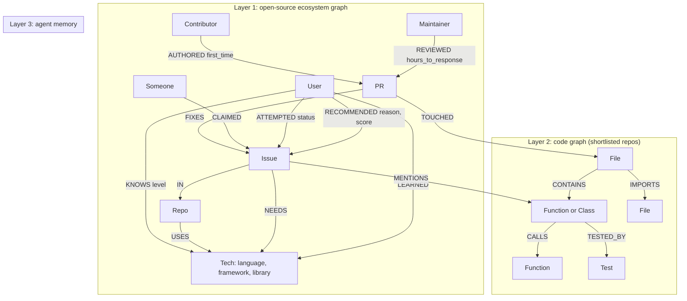

# Breadcrumbs: feature and database design

> **Tag line:** *"Follow the trail from issue to merged PR."*
>
> **One line:** "Enter your GitHub username. Get open-source issues you can actually get merged, from your first PR to your next one, plus a lit-up trail through the code to the fix."

**Positioning:** the product is **general** (your *next* contribution, at any level). The demo story is a **first-timer's journey**, with a closing slide showing the same engine for an experienced developer.

Interface prototype: [breadcrumbs_ui_prototype.html](breadcrumbs_ui_prototype.html)

Track fit: **Agents That Act on Connected Data** (matching issues, finding code, planning) + **Agent Memory** (your contribution history, so each recommendation builds on the last).

## 1. The problem and the gap

People new to open source give up because:
1. **"Good first issue" labels mislead:** many of those issues are stale, already claimed in the comments, or not actually beginner-sized.
2. **Maintainers who don't respond:** a newcomer's first PR sits for weeks and they never come back.
3. **"Where do I even start in this codebase?":** cloning a 200k-line repository is overwhelming.

Existing tools (goodfirstissue.dev, up-for-grabs, CodeTriage) **list labelled issues**. None of them **match an issue to your skills, check whether it's claimed, check how quickly maintainers respond, or guide you through the code.** That gap is ours, and every part of it involves following connections across data, which is what a graph does well.

## 2. Features

| # | Feature | What the user sees | 48h scope |
|---|---|---|---|
| F1 | **Skill fingerprint** | Enter a GitHub username → skill radar: languages, frameworks and libraries (from the dependency files in their repos), experience level | ✅ Core |
| F2 | **Issue matchmaker** | 3–5 ranked issue cards, each with a **fit score and a plain-language "why"**: "matches your React + Jest experience · unclaimed · maintainer usually replies within 6h · 4 first-time contributors merged here last month · touches only 2 small files" | ✅ Core |
| F3 | **Contribution map** (main demo moment) | Click an issue → an interactive code map **lights up the path**: issue → the functions it's about → their callers → the related test file, with a numbered **reading order** ("read these 4 files in this order") | ✅ Core |
| F4 | **Precedent finder** | "A first-time contributor fixed a similar bug in PR #812, touching the same file; reviewed by @maintainer in 4h." Earlier merged PRs that touched the same code, as worked examples | ✅ Core |
| F5 | **Contribution coach** (agent chat) | Ask about this repo: "How do I run the tests?", "What does `parseConfig` do?", "Write my 'can I take this?' comment", "Write my PR description following CONTRIBUTING.md". Every answer comes from the graph and the repo's files | ✅ Core (lighter version) |
| F6 | **Growth ladder** | After a PR is merged, the skill graph updates and the agent suggests a slightly harder next issue in the same repo: good first issue → medium → core | 🟡 Stretch: one demo step |
| F2b | **"Contribute to what you already use"** | Dependency files in the user's repos → libraries they depend on → open issues that match their skills ("📦 In your dependencies" chip). Graph path: `(User)-[:OWNS]->(Repo)-[:DEPENDS_ON]->(Repo)<-[:IN]-(Issue)` | ✅ Core (~2h) |
| F2c | **Difficulty that grows with you** | The fit score targets one level above current mastery in each skill, so beginners get easy issues and experienced developers get core or maintainer-priority issues | ✅ Core (~1h) |
| F2d | **Merge forecast** | A merge-probability ring on each issue card, combining skill fit, claimed status, maintainer reply speed, recent first-timer merges and how central the code is | ✅ Core (UI on top of query a) |
| F7 | **Mentor match** | "@alice merged 3 PRs in this exact folder and is on Breadcrumbs" | ✂️ Pitch slide (show the query) |
| F8 | **Maintainer view** | Maintainers see newcomers well matched to their issues: the other side of the marketplace | ✂️ Pitch slide |

## 3. How FalkorDB is used (one graph, three layers)



### Layer 1: open-source ecosystem graph
**Nodes:** `User`, `Repo`, `Issue`, `PR`, `Tech`, `Label`.
**Edges:**
- `(User)-[:KNOWS {level}]->(Tech)`, worked out from the user's repos, languages, dependency files and commit counts.
- `(Repo)-[:USES]->(Tech)`
- `(Issue)-[:IN]->(Repo)`
- `(Issue)-[:NEEDS]->(Tech)`: the LLM tags each issue with the technologies it involves.
- `(PR)-[:FIXES]->(Issue)`
- `(User)-[:AUTHORED {first_time}]->(PR)`
- `(User)-[:REVIEWED {hours_to_first_response}]->(PR)`
- `(User)-[:CLAIMED {at}]->(Issue)`: detected by the LLM from comments like "can I work on this?" or "assigned to me".
- `(PR)-[:TOUCHED]->(File)`: the bridge into Layer 2.

### Layer 2: code graph (built only for repos on the user's shortlist)
**Nodes:** `File`, `Function`, `Class`, `Test`.
**Edges:**
- `CONTAINS`, `CALLS`, `IMPORTS`
- `TESTED_BY`: a heuristic based on file names, imports and calls from test files.
- `(Issue)-[:MENTIONS]->(Function|File)`: the bridge from an issue's text to the code.

Parse the code with **tree-sitter**.
> [!TIP]
> FalkorDB's open-source **code-graph** project already parses code with tree-sitter. Consider reusing its parsers, with credit, to save around 6 hours. Spend that time on what's new: matching issues to people, reading order, earlier PRs as examples, and agent memory. Those are what make Breadcrumbs different from their showcase.

### Layer 3: agent memory
- `(User)-[:RECOMMENDED {score, reason, at}]->(Issue)`: every recommendation is stored and explainable.
- `(User)-[:ATTEMPTED {status: claimed|pr_open|merged|abandoned}]->(Issue)`
- `(User)-[:LEARNED]->(Tech)`: skills gained from merged PRs, which feed the growth ladder.

### FalkorDB features we use (and why judges will notice)
| Feature | Used for |
|---|---|
| **Cypher queries several hops deep** | Matching skills to issues, finding earlier PRs, finding mentors, the bridge from code to people |
| **Vector index** (HNSW) on `Issue.embedding` and `Function.summary_embedding` | Matching issue text to the right functions (finding the code). Semantic issue search |
| **Full-text index** on `Function.name` and `File.path` | Exact matches when an issue names a symbol or a file path |
| **`algo.pageRank`** on `CALLS` | How central a function is: a beginner-friendly issue touches **low-centrality** code. Also chooses which file to read first |
| **`algo.SPpath` / BFS** | The reading order: shortest path from an entry point (CLI/main/route) to the function to change, then to its test |
| **`algo.wcc`** | Clusters of modules, for "this issue lives in the `parser` module" |
| **GraphRAG SDK** (text-to-Cypher) | A fallback in the chat for open-ended questions |

### The "remove FalkorDB" test (the hackathon's rule)
Without the graph, every core feature breaks:
- **F2** needs the hops user → tech ← repo ← issue, plus maintainer review history and claim status.
- **F3** is literally a path through the call graph.
- **F4** needs PR → file ← PR links.
- **F6/F7** need memory and links between people.

A vector database alone could find issues with *similar text*. It can't tell you whether an issue is **fixable by you, unclaimed, from a responsive repo, or where its code lives**.

## 4. Key queries (drafts, check against FalkorDB on day 1)

**a) Issue matching (F2)**
```cypher
MATCH (u:User {login:$login})-[k:KNOWS]->(t:Tech)<-[:NEEDS]-(i:Issue {state:'open'})-[:IN]->(r:Repo)
WHERE NOT ( ()-[:CLAIMED]->(i) ) AND i.updated_at > $freshCutoff
WITH u, i, r, sum(k.level) AS skillMatch, collect(t.name) AS matchedTech
OPTIONAL MATCH (r)<-[:IN]-(:Issue)<-[:FIXES]-(p:PR)<-[rv:REVIEWED]-(:User)
WITH i, r, skillMatch, matchedTech, avg(rv.hours_to_first_response) AS respHours
OPTIONAL MATCH (r)<-[:IN]-(:Issue)<-[:FIXES]-(fp:PR)<-[:AUTHORED {first_time:true}]-(:User)
WHERE fp.merged_at > $recentCutoff
RETURN i.url, r.name, matchedTech, respHours, count(fp) AS recentFirstTimers,
       skillMatch * (1.0 / (1 + coalesce(respHours, 72) / 24)) * (1 + log(1 + count(fp))) AS fit
ORDER BY fit DESC LIMIT 5
```

**b) Finding the code (F3): vector search, then expand along calls**
```cypher
CALL db.idx.vector.queryNodes('Function', 'summary_embedding', 8, vecf32($issueEmbedding))
YIELD node AS fn, score
WHERE fn.repo = $repo
OPTIONAL MATCH (caller:Function)-[:CALLS]->(fn)
OPTIONAL MATCH (fn)-[:TESTED_BY]->(t:Test)
RETURN fn.name, fn.file, score, collect(DISTINCT caller.name)[..3] AS callers, collect(DISTINCT t.file) AS tests
ORDER BY score DESC LIMIT 3
```

**c) Reading order (F3): entry point → target → test**
```cypher
MATCH (entry:Function {repo:$repo, is_entrypoint:true}), (target:Function {id:$targetId})
MATCH p = shortestPath((entry)-[:CALLS*..6]->(target))
OPTIONAL MATCH (target)-[:TESTED_BY]->(t:Test)
RETURN [n IN nodes(p) | n.file + '#' + n.name] AS readingOrder, t.file AS testFile
ORDER BY length(p) ASC LIMIT 1
```

**d) Earlier PRs as examples (F4)**
```cypher
MATCH (fn:Function {id:$targetId})<-[:CONTAINS]-(f:File)<-[:TOUCHED]-(p:PR {merged:true})
MATCH (a:User)-[au:AUTHORED]->(p)
OPTIONAL MATCH (rv:User)-[r:REVIEWED]->(p)
RETURN p.url, p.title, au.first_time, rv.login, r.hours_to_first_response
ORDER BY au.first_time DESC, p.merged_at DESC LIMIT 3
```

**e) How central the code is (beginner safety, F2 and F3)**
```cypher
CALL algo.pageRank('Function', 'CALLS') YIELD node, score
SET node.centrality = score
```
Fit score penalty: issues whose mentioned functions have high `centrality` are marked "core code: harder".

**f) Mentor match (F7, pitch slide)**
```cypher
MATCH (fn:Function {id:$targetId})<-[:CONTAINS]-(f:File)<-[:TOUCHED]-(p:PR {merged:true})<-[:AUTHORED]-(mentor:User {on_platform:true})
RETURN mentor.login, count(p) AS prsHere ORDER BY prsHere DESC LIMIT 3
```

## 5. How the agent works (LangGraph)

**Loop:** sense (sync from GitHub) → match (F2) → investigate (F3/F4) → act (draft the claim comment, set up locally, draft the PR description) → remember (Layer 3).

| Tool | What it does |
|---|---|
| `build_fingerprint(login)` | GitHub API → repos, languages, dependency files → `KNOWS` edges |
| `match_issues(login)` | Query a + LLM "why" text built from the query's columns |
| `index_repo(repo)` | Clone (shallow) → tree-sitter → Layer 2 + embeddings + pageRank |
| `locate_code(issue)` | Query b (+ full-text search for named symbols) → `MENTIONS` edges |
| `reading_path(issue)` | Query c → returns the path for the interface to highlight |
| `find_precedents(issue)` | Query d |
| `repo_howto(repo, question)` | Answers from README/CONTRIBUTING/CI config + the graph |
| `draft_claim_comment` / `draft_pr_description` | LLM drafts that follow the repo's CONTRIBUTING rules (the user posts them) |
| `graph_qa(question)` | GraphRAG SDK text-to-Cypher fallback |
| `remember(event)` | Writes `RECOMMENDED` / `ATTEMPTED` / `LEARNED` edges |

**Rule for answers:** every claim cites a graph result (issue/PR links, file#function).

## 6. Data pipeline (48h scope)

1. **Hand-pick ~30–50 beginner-friendly repos** in 2 languages (TypeScript/JavaScript + Python), active within the last 3 months.
2. Use the **GitHub GraphQL API** (authenticated token; stay within the rate limits and cache everything) to pull open issues, comments, PRs from the last 6 months, reviews, files changed, contributor histories and dependency files.
3. **LLM enrichment** (batched, cached): `NEEDS` tags for each issue, claim detection from comments, a size estimate for each issue.
4. **Build code graphs ahead of time for ~10 repos** (the ones used in the demo). Building one live on demand is a stretch goal.
5. An idempotent `seed.py` + a JSON snapshot, so the demo never depends on the GitHub API being up.

## 7. Interface (the screens judges remember)
1. **Landing:** one input box for the GitHub username → an animated skill radar builds up.
2. **Matches:** 3–5 issue cards with fit scores, coloured "why" chips (skill / unclaimed / fast maintainer / small scope) and a difficulty bar.
3. **Contribution map** (main screen): a force-directed code map (react-force-graph). The path **lights up step by step** with numbered reading order. A side panel shows earlier PRs and the coach chat.
4. **Journey:** timeline of recommended → claimed → PR → merged, and the next rung on the ladder.

## 8. Demo script (3 minutes)
1. **(0:00) Problem:** "60% of good first issues are stale or claimed" (measure the real number on your dataset and show it; it makes a great opening statistic).
2. **(0:20)** Enter a judge's GitHub username → skill radar → **"3 issues you can close this weekend"**, each with its why.
3. **(0:50)** Click one → **the code map lights up** issue → `parseConfig` → its caller in `cli.ts` → `config.test.ts`, with a numbered reading order.
4. **(1:30)** Earlier PR: "a first-timer fixed a similar bug here in PR #812; the maintainer replied in 4h."
5. **(1:50)** Coach: "how do I run tests?" → an exact command from the CI config. "Write my claim comment" → done.
6. **(2:20)** Side-by-side: goodfirstissue.dev / ChatGPT gives a list of labelled issues; Breadcrumbs gives fit + status + path.
7. **(2:40)** Close: growth ladder + mentor-match slide + "the same engine helps companies onboard new engineers".

## 9. Two-person split (48h)
| Hours | Person A: data + graph | Person B: agent + interface |
|---|---|---|
| 0–2 | FalkorDB, schema, indexes, `seed.py` skeleton | FastAPI + Next.js skeleton, LiteLLM |
| 2–12 | GitHub ingestion (repos, issues, PRs, reviews) + LLM enrichment (NEEDS, claims) | Fingerprint builder + matchmaker query + issue cards |
| 12–20 | Code graphs for ~10 repos (tree-sitter) + embeddings + pageRank | LangGraph agent + tools wired to queries a–d |
| 20–26 | 😴 | 😴 |
| 26–36 | Tune queries b–d (finding code, reading order, earlier PRs) on real issues | Contribution map interface with step-by-step path highlighting |
| 36–42 | Measure the "stale/claimed" statistic; Layer 3 memory; growth ladder step | Coach chat + drafts; polish; deploy |
| 42–48 | README + architecture diagram + backup video | Rehearse the demo ×3, submit |

**Never cut:** F2 matching with its why, F3 lit-up code path, F4 earlier PRs. **Cut first:** live repo indexing, growth ladder, mentor match.

## 10. Risks
| Risk | Mitigation |
|---|---|
| Finding the wrong code for an issue | Combine vector + full-text + symbols named in the issue; show the top 3 with confidence scores; demo issues checked in advance |
| Detecting claims in comments incorrectly | Conservative LLM prompt + check assignees + "last activity" time |
| Code graph parsing is slow or incomplete | Pre-index the demo repos; limit to 2 languages |
| GitHub rate limits | Authenticated token, caching, snapshot |
| "FalkorDB already has code-graph" | Our value is **matching people to issues + reading order + earlier PRs + memory**; credit their parser if we reuse it |
